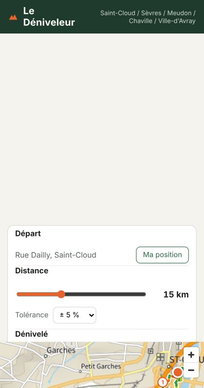
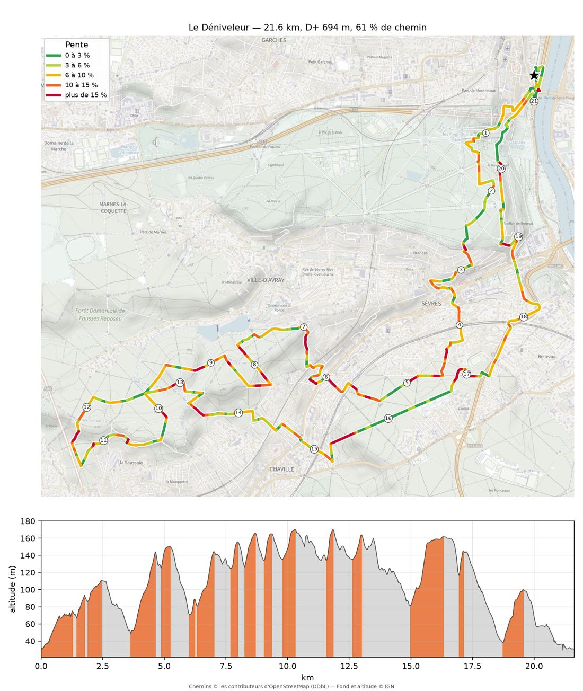

# Le Déniveleur

Générateur de boucles trail qui cherche le **maximum de dénivelé positif (D+)**, ou un
D+ choisi, pour une distance donnée — et sort un fichier GPX prêt à charger dans une
montre ou dans Strava.

## L'objectif

Depuis un point de départ (par défaut la rue Dailly à Saint-Cloud), proposer en moins
d'une minute une boucle de 20 à 22 km avec **au moins 550 m de D+**, sans repasser deux
fois au même endroit.

La référence à battre est un tracé fait à la main : 25,1 km pour 579 m de D+.

## Où en est le projet

| Étape | Contenu | État |
|---|---|---|
| 1 | Cadrage : repo, vérifications automatiques, décisions d'architecture | ✅ |
| 2 | Données : chemins OpenStreetMap + altitude IGN, secteur Saint-Cloud / Meudon | ✅ |
| 3 | Moteur en ligne de commande : boucle à D+ maximal, export GPX | ✅ |
| 4 | D+ cible et estimation du temps de parcours | ✅ (sauf « temps cible ») |
| 5 | Site web utilisable sur téléphone | ✅ (mise en ligne en cours) |
| 6 | Intervalles en côte | à venir |
| 7 | Préférences avancées (pente, escaliers, surface, portions en double) | à venir |
| 8 | Options : connexion Strava, autres régions, hébergement public | à venir |

Le détail est dans [docs/feuille-de-route.md](docs/feuille-de-route.md).

## Le site

Une page web, pensée pour le téléphone : on place le départ sur la carte (ou « Ma
position »), on choisit la distance, **le plus de D+ possible ou un D+ visé**, et les
contraintes (éviter les escaliers, part minimale de sentier). En une trentaine de
secondes, le site propose jusqu'à trois boucles différentes, avec la carte colorée par
la pente, le profil, les côtes, le temps estimé et le **fichier GPX à télécharger**.



Pour le lancer sur son ordinateur, après l'installation ci-dessous :

```bash
deniveleur site          # puis ouvrir http://localhost:8000
```

Pour le mettre en ligne gratuitement : [docs/deploiement.md](docs/deploiement.md).

## Ce que ça donne aujourd'hui

Depuis la rue Dailly, pour 21 km demandés, le moteur trouve en moins de 30 secondes
une boucle de **21,5 km avec 759 m de D+** (référence à battre : 579 m sur 25,1 km).
En exigeant au moins 50 % de sentier et aucun escalier, on obtient encore environ
**690 m de D+ sur 21,6 km**, comme cette boucle :



Ces D+ sont calculés avec notre modèle d'altitude. Il a été comparé à Strava sur quatre
sorties réelles : +2 % au total, 7 % d'écart moyen ([détail](docs/validation-denivele.md)).
Les résultats sur six cas de référence sont dans
[benchmarks/rapport.md](benchmarks/rapport.md), le fonctionnement du moteur dans
[docs/algorithme.md](docs/algorithme.md).

## Essayer

Il faut Python 3.11 ou plus récent.

```bash
git clone https://github.com/simeongug/Le-D-niveleur.git
cd Le-D-niveleur
python -m venv .venv && source .venv/bin/activate
pip install -e ".[dev]"

deniveleur donnees tout     # une seule fois : télécharge les données et construit le réseau
```

Le premier lancement télécharge environ 500 Mo et prend quelques minutes.

Puis, pour générer une boucle :

```bash
# Boucle de 21 km au D+ maximal depuis la rue Dailly
deniveleur boucle --depart 48.8428,2.2215 --distance 21

# Trois propositions, au moins 50 % de sentier, sans escaliers
deniveleur boucle --depart 48.8428,2.2215 --distance 21 --propositions 3 --chemin-min 50 --sans-escaliers
```

Chaque proposition donne un fichier GPX et une carte avec le profil, dans le dossier
`sorties/`. Le GPX s'importe dans Strava (« Créer un itinéraire » → importer), Garmin
Connect, Suunto ou Coros.

| Option | Effet |
|---|---|
| `--depart lat,lon` | point de départ (le chemin le plus proche est utilisé) |
| `--distance 21` | distance visée en km |
| `--tolerance 5` | écart permis sur la distance, en % (5 par défaut) |
| `--propositions 3` | nombre de boucles différentes à proposer |
| `--chemin-min 50` | part minimale de sentier ou de piste, en % |
| `--sans-escaliers` | évite les escaliers |
| `--temps 40` | temps de recherche en secondes (25 par défaut) |
| `--graine 2` | autre tirage : donne d'autres boucles |

Pour viser un D+ précis plutôt que le maximum, utiliser le site (le moteur le fait avec
moins de 1 % d'écart sur 20 km, de 200 à 500 m visés).

Autres commandes : `deniveleur denivele ma-sortie.gpx` mesure le D+ d'un tracé, et
`deniveleur donnees carte` dessine la carte des pentes (voir
[docs/donnees.md](docs/donnees.md)).

## Vérifications automatiques

À chaque modification envoyée sur GitHub, deux contrôles tournent tout seuls :

- **ruff** vérifie le style du code ;
- **pytest** lance les tests (dont des boucles générées sur un petit terrain artificiel).

Pour les lancer à la main :

```bash
ruff check . && ruff format --check .
pytest
```

## Organisation du repo

```
src/deniveleur/     le code de l'application (moteur/, site/)
deploiement/        installation automatique sur un serveur
src/deniveleur/config/parametres.toml   tous les réglages
tests/              les tests automatiques
benchmarks/         les cas de référence du moteur et leur dernier rapport
docs/decisions/     les choix d'architecture et leurs raisons
docs/               la feuille de route, les données, l'algorithme, la validation du D+
.github/workflows/  les vérifications automatiques
```

## Décisions d'architecture

1. [Python comme langage](docs/decisions/0001-langage-python.md)
2. [Un réseau de chemins préparé à l'avance](docs/decisions/0002-reseau-prepare-a-l-avance.md)
3. [Un moteur indépendant de l'interface et des régions](docs/decisions/0003-moteur-independant.md)
4. [Altitude à 2 m et réseau enregistré en tableaux](docs/decisions/0004-altitude-et-format-du-reseau.md)
5. [Héberger le site sur le serveur gratuit d'Oracle Cloud](docs/decisions/0005-hebergement-oracle.md)

## Données

- Chemins : © les contributeurs d'[OpenStreetMap](https://www.openstreetmap.org/copyright), licence ODbL.
- Altitude et fond de carte : IGN (RGE ALTI®, Plan IGN), Licence Ouverte Etalab 2.0.
- Affichage de la carte : MapLibre GL JS (licence BSD), intégré au site.

Le projet n'utilise pas la carte de chaleur de Strava.
